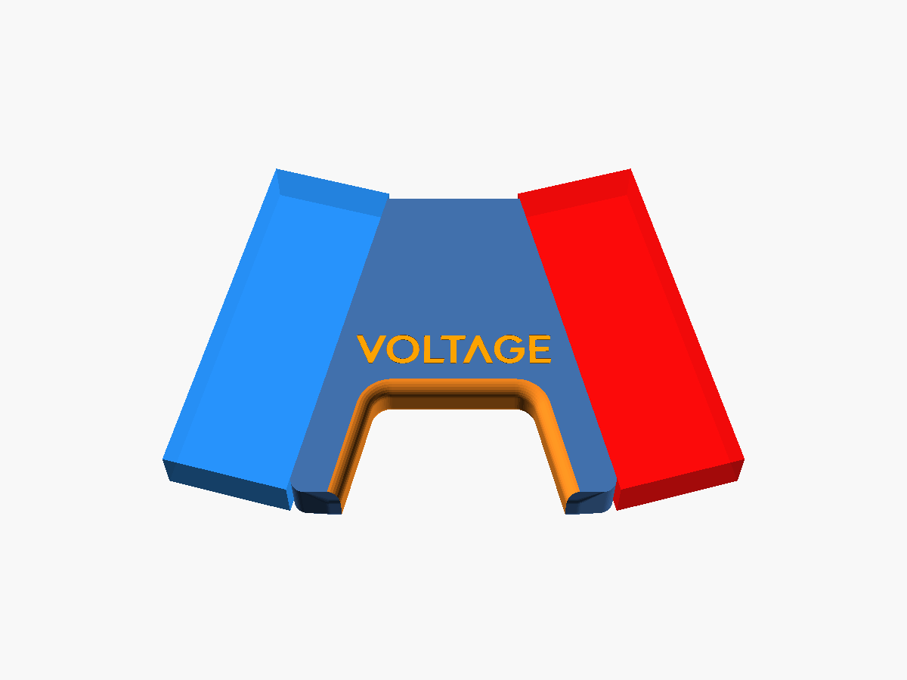
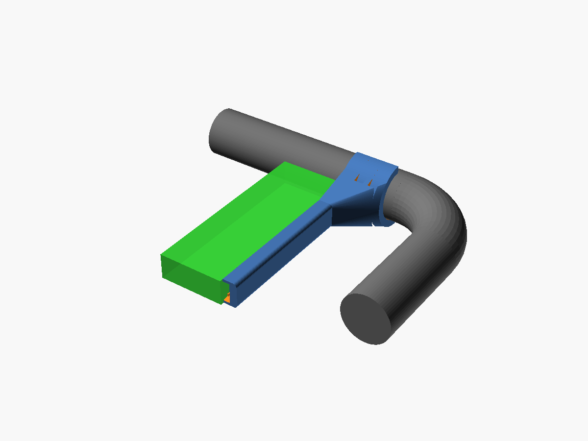

# Controller Cycling Mounts

3D-printable mounts that put ordinary game controllers on a bike, so you can
use them for shifting and steering in Zwift on an indoor trainer. They are the
hardware side of a separate Windows app (another repository) that connects
standard game controllers to Zwift.

Every model is **OpenSCAD source**: use it as is, change the settings, or build
your own mounts on the shared rail and cleat code.

**Just want to print?** Download the STL/3MF files from the
[latest release](../../releases/latest).

## Mounts

### Nintendo Joy-Con (original Switch)

Start with the [Joy-Con guide](joycon/): print the two fit tests first.

| | Mount | Attaches to | Status |
| --- | --- | --- | --- |
|  | [**Garmin grip**](joycon/garmin-grip/): both Joy-Cons in one gamepad-style grip | Any Garmin quarter-turn mount (out-front, stem) | Ready: rail and cleat fit tests passed |
|  | [**Handlebar mount**](joycon/handlebar-mount/): one Joy-Con per side, like Zwift Play | Clamps to the bar tops (strap or bolt clamp) | Prototype |

### Coming later

- Joy-Con 2 (Switch 2): attaches magnetically, needs its own designs.

## Download or build

- **Ready-to-print files:** each [release](../../releases) has STL and 3MF
  files for every mount, already oriented for printing, plus single-file
  `.scad` versions for MakerWorld's customizer.
- **Customize in OpenSCAD** (2021.01 or newer):
  1. Clone or download the whole repo. The models load the shared code from
     `lib/` and `assets/` by relative path, so keep the folders together.
  2. Open a mount's `.scad` file, then **Window → Customizer** to change
     settings.
  3. **F6** to render, then **File → Export**.
- **Build everything:** `tools/build.sh` writes all STL/3MF files to `build/`
  and refreshes the preview images. `tools/bundle.py --all` writes the
  single-file versions. Both need `openscad` on your PATH.

## Printing

- **Material:** PETG or ASA. Trainer setups get warm and sweaty, and PLA can
  creep under a spring clip. PLA is fine for fit tests.
- **Orientation:** keep the orientation in the release files. Mounts with
  Joy-Con rails stand up so the rails run vertically. Printed flat, one rail
  lip would start in mid-air.
- **Supports:** none. Use a brim on tall parts.
- **Strength:** 4+ walls, 25 %+ infill.

## Repo layout

```
joycon/              Nintendo Joy-Con (original Switch)
  fit-tests/           Rail and Garmin cleat tests: print these first
  garmin-grip/         Two Joy-Cons on a Garmin quarter-turn cleat
  handlebar-mount/     One Joy-Con per side, clamped to the bar
lib/                 Shared OpenSCAD code (Joy-Con rail, Garmin cleat)
assets/              Logo SVG
docs/                Design notes and measured reference dimensions
tools/               build.sh, bundle.py, targets.txt
.github/workflows/   Builds every model; tagged versions become releases
```

Each mount folder has its `.scad` source, a README and preview images. STL and
3MF files are build output: they are not committed, they are attached to
releases.

## Publishing a release (maintainers)

Tag a version and push it; GitHub Actions builds every model and attaches the
files to a new release:

```
git tag v1.0.0
git push origin v1.0.0
```

Pushes and pull requests run the same build as a check.

## Credits

Dimensions were measured from these community models (thank you!). Only
measurements were taken: no third-party meshes or code are included here.

- *Joycon Grip w/ Front Look LED Window* (by ecoiras and its remixes, including
  HUSQY_'s narrower version): Joy-Con rail profile, splay and spacing
- *DiTec case + Garmin connection* (DefMaker), *ReverseGarminCustomv2*, and a
  cleat shared as *Shiny Allis-Bojo*: Garmin quarter-turn cleat geometry
- [Cuttlephone](https://github.com/SiloCityLabs/Cuttlephone): early Joy-Con
  rail reference

Measured values and design reasoning: [docs/design-notes.md](docs/design-notes.md).

## Contributing

Issues and pull requests are welcome, especially fit reports (printer,
material, which settings you changed) and mounts for other controllers.

- Put each controller in its own top-level folder, with a `fit-tests/` folder
  if it needs one.
- Put reusable geometry in `lib/` with a clear local coordinate frame.
- Keep a design's settings at the top of its file, in Customizer sections.
- Add new printable parts to `tools/targets.txt` so releases include them.
- Don't commit STL/3MF files or third-party meshes.

## License

Copyright © 2026 Voltage Solutions LLC.

[CC BY-SA 4.0](LICENSE): you may use, change, print and sell these designs,
as long as you credit this project and share your changed versions under the
same license.

The VOLTAGE wordmark (`assets/voltage_wordmark.svg`, and the logo recessed into
some designs) is a trademark of Voltage Solutions LLC and is not covered by
this license. If you share or sell your own version of a design, set
`logo = false` in the Customizer or replace `logo_file` with your own logo.
