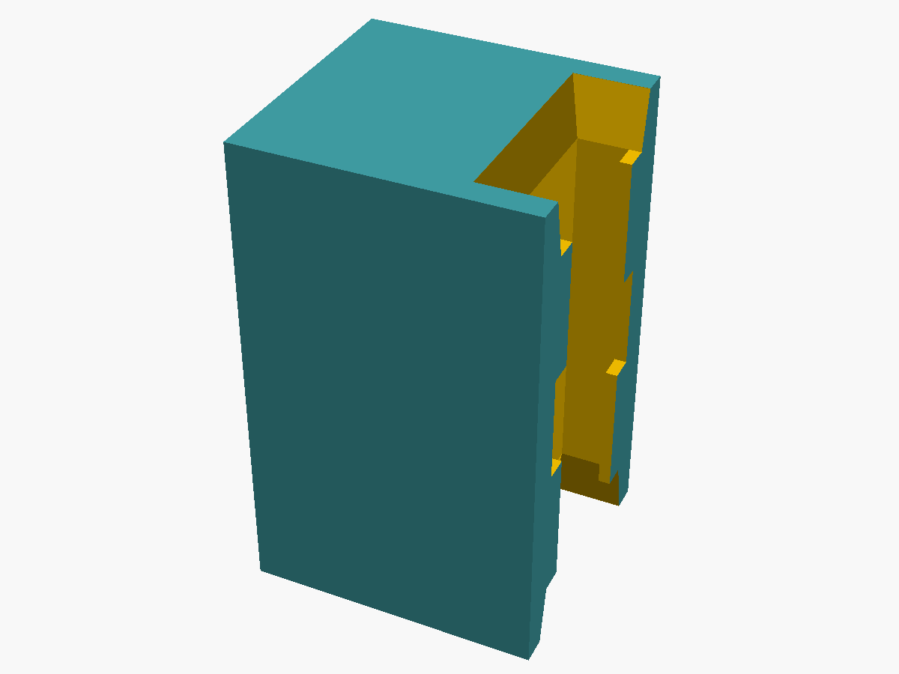
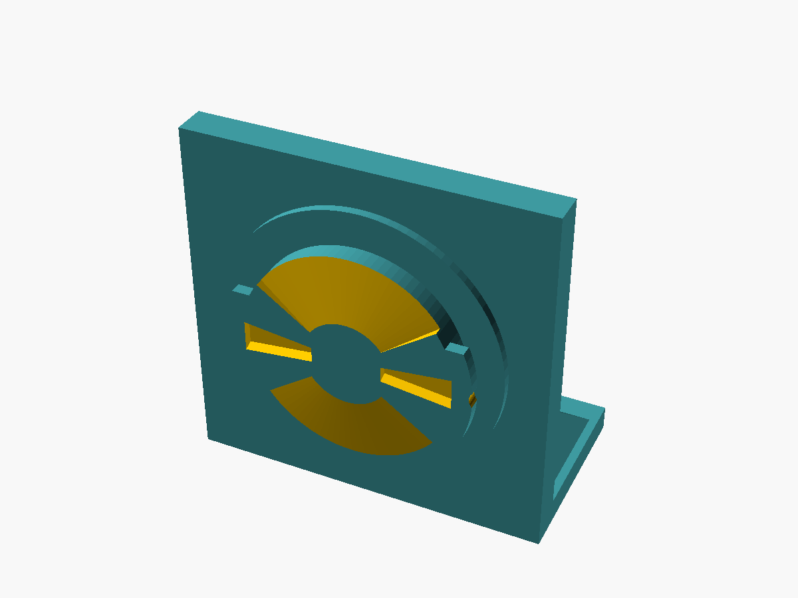
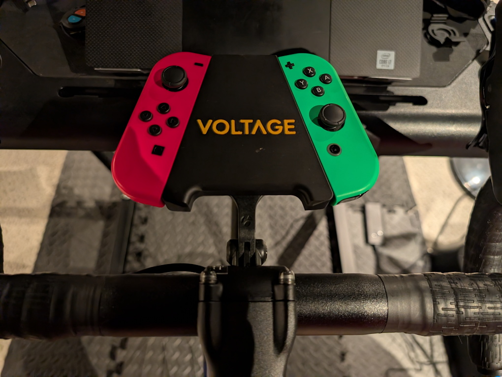

# Nintendo Joy-Con mounts

This mount is for the **original Nintendo Switch Joy-Cons**, not the Switch 2 Joy-Cons.

## 1. Print the fit tests

Results vary by printer. I recommend you print the test Joy-Con rail and test Garmin quarter-turn cleat. This will enable you to locate and adjust any issues on the main print before wasting filament.

| Test | Checks |
| --- | --- |
|   [Rail test](fit-tests/) | The Joy-Con slides on smoothly and the latch clicks |
|   [Cleat test](fit-tests/) | The cleat drops into your Garmin mount, twists, and clicks |

What to look for and which setting to change if a test is tight or loose:
[fit-tests/README.md](fit-tests/README.md).

## 2. Pick a mount

| | Mount | Attaches to | Status |
| --- | --- | --- | --- |
|  | [Garmin grip](garmin-grip/): both Joy-Cons, gamepad style | Any Garmin quarter-turn mount | Ready: fit tests passed, aero version tested on a bike |

**Garmin grip:** check that it can twist on your mount before printing. It
is much bigger than a bike computer: see
[Fit it to your bike mount](garmin-grip/README.md#fit-it-to-your-bike-mount-check-before-printing).

Ready-to-print STL/3MF files for everything here are in the
[latest release](../../../releases/latest).
