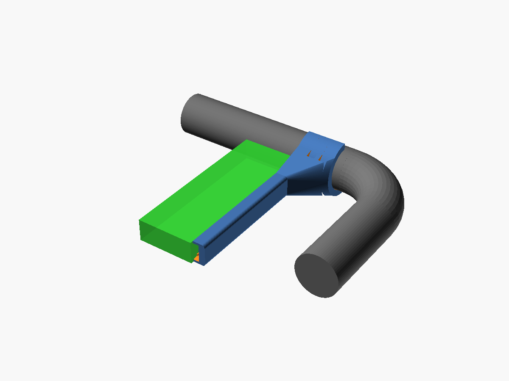

# Nintendo Joy-Con mounts

Mounts for **original Nintendo Switch Joy-Cons** (and third-party ones with the
same metal rail). Joy-Con 2 (Switch 2) attaches magnetically and won't fit
these rails.

## 1. Print the fit tests

Every mount here uses the same Joy-Con rail, and the Garmin grip uses a
quarter-turn cleat. Both have to fit precisely, and fit depends on your
printer. Two small prints (a few minutes each) check them before you print a
full mount:

| Test | Checks |
| --- | --- |
|  [Rail test](fit-tests/) | The Joy-Con slides on smoothly and the latch clicks |
|  [Cleat test](fit-tests/) | The cleat drops into your Garmin mount, twists and clicks |

What to look for and which setting to change if a test is tight or loose:
[fit-tests/README.md](fit-tests/README.md).

## 2. Pick a mount

| | Mount | Attaches to | Status |
| --- | --- | --- | --- |
|  | [Garmin grip](garmin-grip/): both Joy-Cons, gamepad style | Any Garmin quarter-turn mount | Ready: rail and cleat fit tests passed |
|  | [Handlebar mount](handlebar-mount/): one Joy-Con per side, like Zwift Play | Bar tops near the bend (strap or bolt clamp) | Prototype |

**Garmin grip:** check that it can twist on your mount before printing. It
is much bigger than a bike computer: see
[Fit it to your bike mount](garmin-grip/README.md#fit-it-to-your-bike-mount-check-before-printing).

Ready-to-print STL/3MF files for everything here are in the
[latest release](../../../releases/latest).
