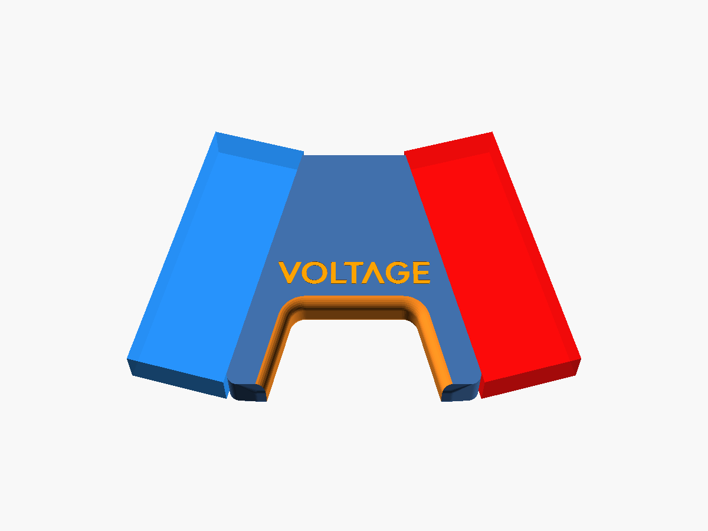
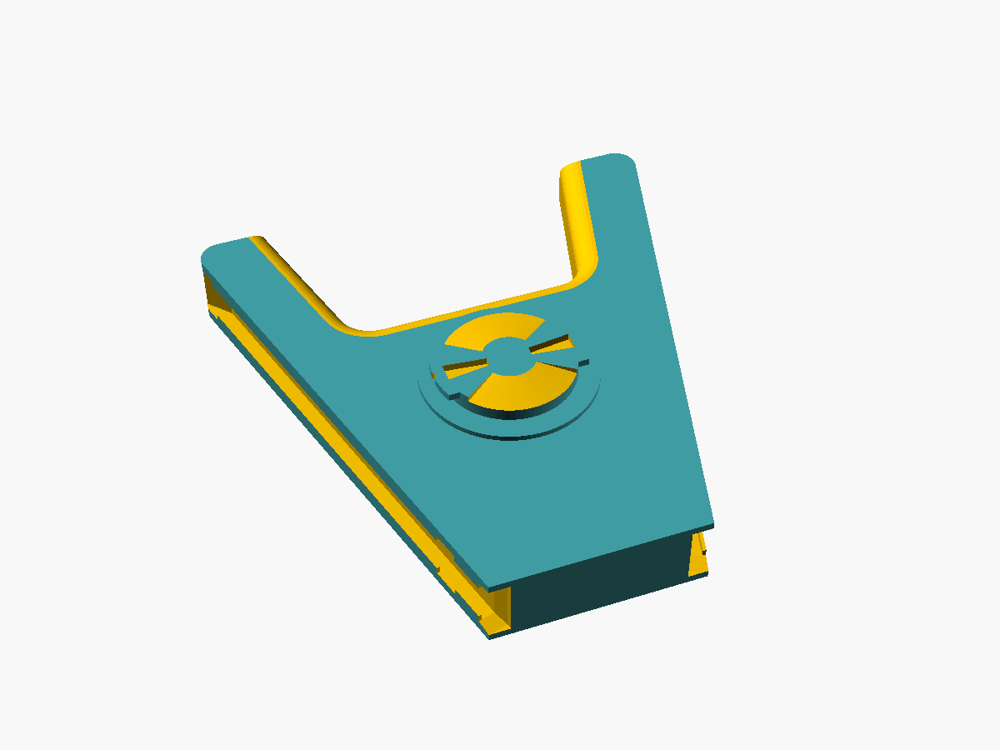
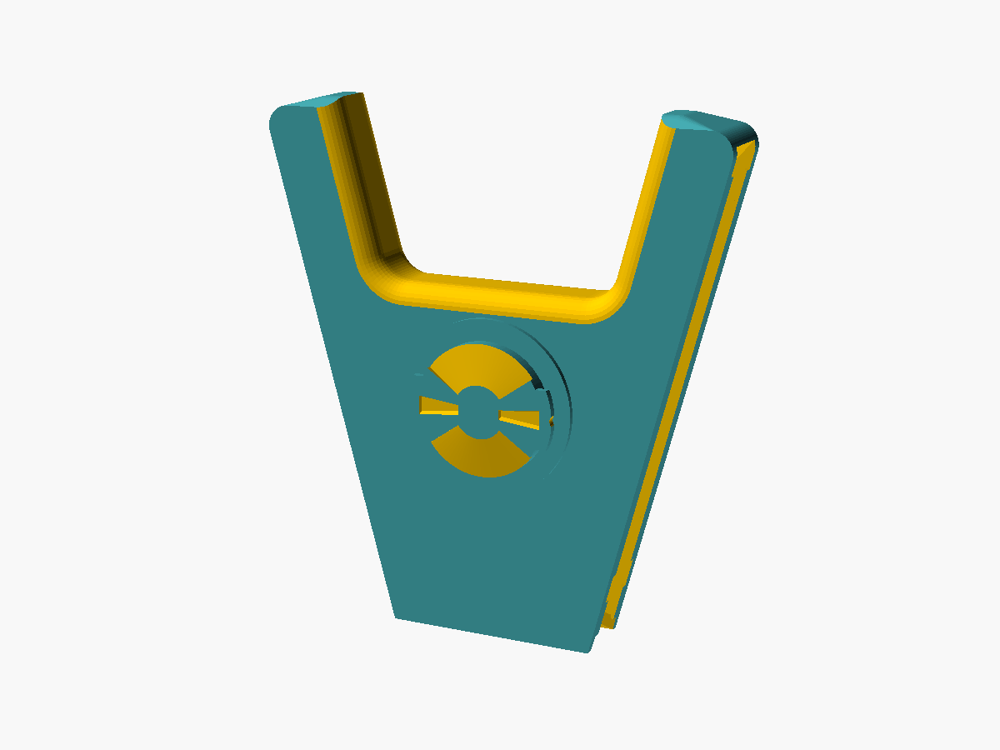
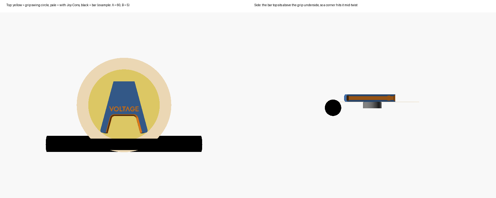

# Joy-Con Garmin grip

Holds two original Nintendo Switch Joy-Cons in a splayed "gamepad" layout,
with a male Garmin quarter-turn cleat underneath. It clicks into any
Garmin-compatible out-front or stem mount, so the controllers sit in front of
the bars like a bike computer.

| Top (with stand-in Joy-Cons) | Underside | Print orientation |
| --- | --- | --- |
|  |  |  |

## Files

- `joycon_garmin_grip.scad`: source. It needs `../../lib/` and `../../assets/`.
- Ready-to-print files in the [latest release](../../../../releases/latest), already oriented:
  - `joycon_garmin_grip_standard`: for mounts that hold the computer above
    the bar. Sits slightly closer to the rider.
  - `joycon_garmin_grip_aero`: for low, aero out-front mounts (such as Trek's
    Blendr) where the standard grip can't twist past the stem. The cleat is
    further back, so less of the grip swings toward the bar.
  - Not sure which? Print the swing tests first (below).

## Fit it to your bike mount (check before printing)

A Garmin mount locks with a quarter turn, so the whole grip has to swing
around the cleat. Out-front mounts sit close to the bar and stem, and this grip
is much bigger than a bike computer. Check your mount before printing:

1. **Measure A:** from the centre of your mount's round cradle, straight back
   toward the rider, to the nearest edge of the handlebar or stem faceplate.
2. **Measure B:** how far the top of that bar or faceplate sits **above** the
   cradle's top surface (the flat ring the cleat sits on). Enter a negative
   number if the bar is lower than the cradle.
3. In OpenSCAD, open **Window → Customizer**, enter A as `mount_bar_dist` and B
   as `mount_bar_height`, then press **F5**.
4. Read the **console** (bottom of the window). It prints the grip's swing
   radius and either `CLEARANCE OK` or `CLEARANCE PROBLEM` with the fix.
   Set `part = clearance` to see it: the yellow disc is the area the grip
   sweeps while twisting, the pale ring the area with Joy-Cons attached, and
   the black bar sits where you measured.
5. If there's a problem, do one or both:
   - **Raise `spacer_h`**: adds a spacer between the cleat and the grip so the
     grip passes over the bar. The console suggests a height. The spacer
     flares out at 45° so it still prints without supports.
   - **Set `mount_style = aero`**: moves the cleat toward the back of the
     grip, so less of it swings toward the bar (53 mm instead of 69 mm). The
     opening at the back gets smaller to make room. For fine-tuning, use
     `custom` and set `cleat_y_frac`.
6. Export and print (**F6**, then **File → Export**).

**Quick physical check (swing test):** `part = swing_test` makes a thin flat
frame in the grip's outline with a plain peg where the cleat goes (about
12 g, prints flat with the peg up, no supports). Flip it over, drop the peg
into your mount's centre hole, line it up straight ahead, and turn it a
quarter turn each way. If the frame clears, the grip will too. Releases
include three: `swing_test_standard`, `swing_test_aero`, and
`swing_test_mid` (halfway between, for checking how much margin you have).

With the defaults the empty grip swings through about a 69 mm radius and
reaches 55 mm behind the cleat when locked. With Joy-Cons attached the swing
is about 91 mm, which almost no mount clears, so always:

- **Lock the empty grip first,** then slide the Joy-Cons in from the front.
- **Remove the Joy-Cons before twisting the grip off.**

## Using it

- Slide each Joy-Con in from the **front** (narrow end), rail first, until it
  stops and the latch clicks. Press the Joy-Con's release button to remove it.
- **Which Joy-Con goes where:** looking down from the saddle, the left Joy-Con
  (− button) goes on the left and the right one (+ button) on the right. The
  sticks face up and the shoulder buttons face forward.
- Lock the empty grip onto the mount first (set the cleat in turned 90°, twist
  until it clicks straight), then slide the Joy-Cons in.
  If it ends up sideways when locked, change `cleat_angle` to 90 and re-export.

## Two-colour logo inlay (optional)

The logo is recessed 1.2 mm so a second-colour inlay can sit flush in it, even
on a single-colour printer. Release files: `joycon_garmin_grip_logo_inlay.stl`
/ `.3mf` (seven letters, 1.2 mm thick).

1. Print the letters flat in the contrasting colour. They print face up;
   top-surface ironing gives them a smoother face.
2. While they're still on the plate, press a strip of masking or painter's
   tape over all of them, then peel the tape off: the letters come with it,
   already spaced correctly.
3. Put a small amount of gel super glue on the backs, line the tape up over
   the recess, press the letters in, and peel the tape away.

If the letters are too tight, raise `inlay_clearance` (try 0.15). If they sit
proud, sand lightly or lower `logo_depth` on the inlay only. Prefer paint?
Fill the recess with a paint marker and wipe the surface clean instead.

## Print orientation

The files stand the grip on its **front end**. The rails then run almost
vertically, so the rail lips don't start in mid-air.

## Customizer parameters

| Section | Parameter | Default | What it does |
| --- | --- | --- | --- |
| What to render | `part` | `grip` | `grip` for printing, `logo_inlay` for the letters, `preview` adds stand-in Joy-Cons, `clearance` shows the swing check, `swing_test` makes the flat test frame |
| | `print_orient` | `true` | Stand the grip on its front end for printing |
| Layout | `splay_angle` | 15° | How far each Joy-Con angles outward |
| | `front_gap` | 40 mm | Distance between the rail faces at the front |
| | `body_t` | 14 mm | Grip thickness (matches the Joy-Con at the rail) |
| | `leg_w` | 15 mm | Leg width, rail face to inner edge |
| | `edge_r` | 4 mm | Rounding of the non-rail edges |
| | `arch`, `arch_corner_r` | on, 6 mm | Opening between the legs at the back |
| Joy-Con rail | `jc_rail_len` | 92.5 mm | Channel length (the Joy-Con bottoms out at the end) |
| | `end_cap` | 7 mm | Closed end behind the channel |
| Garmin cleat | `mount_style` | `standard` | `standard`: for mounts above the bar. `aero`: for low aero mounts. `custom`: use `cleat_y_frac` |
| | `cleat_y_frac` | 0.55 | Custom cleat position, 0 = back, 1 = front |
| | `cleat_angle` | 0 | 0 = lugs left/right; 90 if it locks in sideways |
| | `spacer_h` | 0 mm | Spacer between cleat and grip, to clear the bar while twisting |
| Mount clearance check | `mount_bar_dist` | 0 (off) | Your measurement A, in mm |
| | `mount_bar_height` | 0 | Your measurement B, in mm (negative if below the cradle) |
| Logo | `logo` | on | Recessed VOLTAGE wordmark on top |
| | `logo_w`, `logo_y_frac`, `logo_depth` | 56 mm, 0.475, 1.2 mm | Size, position, recess depth (= inlay thickness) |
| | `inlay_clearance` | 0.10 mm | Gap per side between the inlay letters and the recess |
| | `inlay_face_down` | false | Mirror the inlay so its bed side becomes the visible face |

Rail and cleat fit (clearances, detents) are set in `lib/joycon_rail.scad` and
`lib/garmin_cleat.scad`, and you check them with the
[fit tests](../fit-tests/).

**Customizer tips**

- Changing `front_gap` / `splay_angle` changes the overall width. Use
  `part = preview` to see where the Joy-Cons will sit.
- Turn `logo` off (or point `logo_file` at your own SVG) for an unbranded
  version. The SVG should contain filled shapes only.
- For MakerWorld, make a single-file version with `tools/bundle.py` (see the
  root README) and upload the logo SVG next to it, or disable the logo.

## Known issues / status

- **Rail:** test print fits well (smooth slide, latch clicks).
- **Cleat:** the first cleat test (v2) dropped into the mount but would not
  turn (the flat-printed lugs sagged). The revised cleat, with sloped lug
  undersides and printed standing up like the grip, twists in and clicks.
- Only fits original Switch Joy-Cons, not Joy-Con 2.
