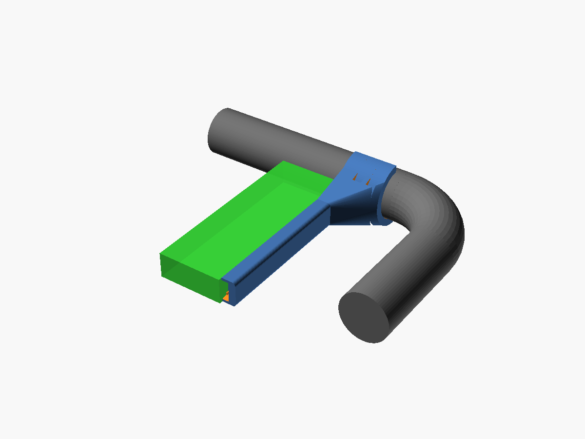
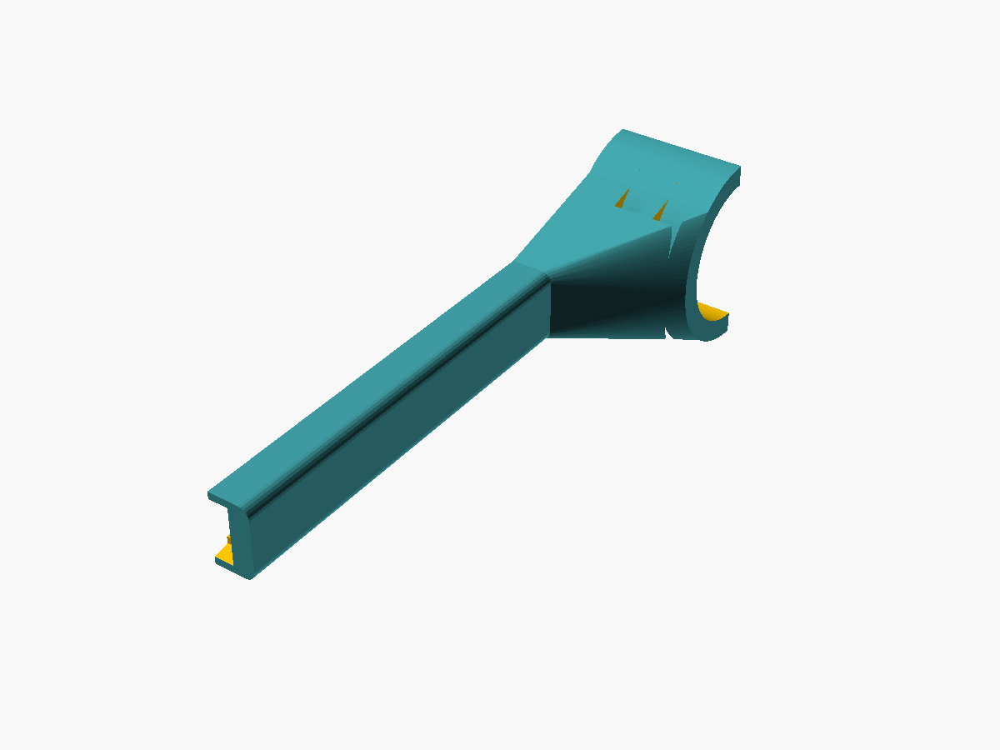
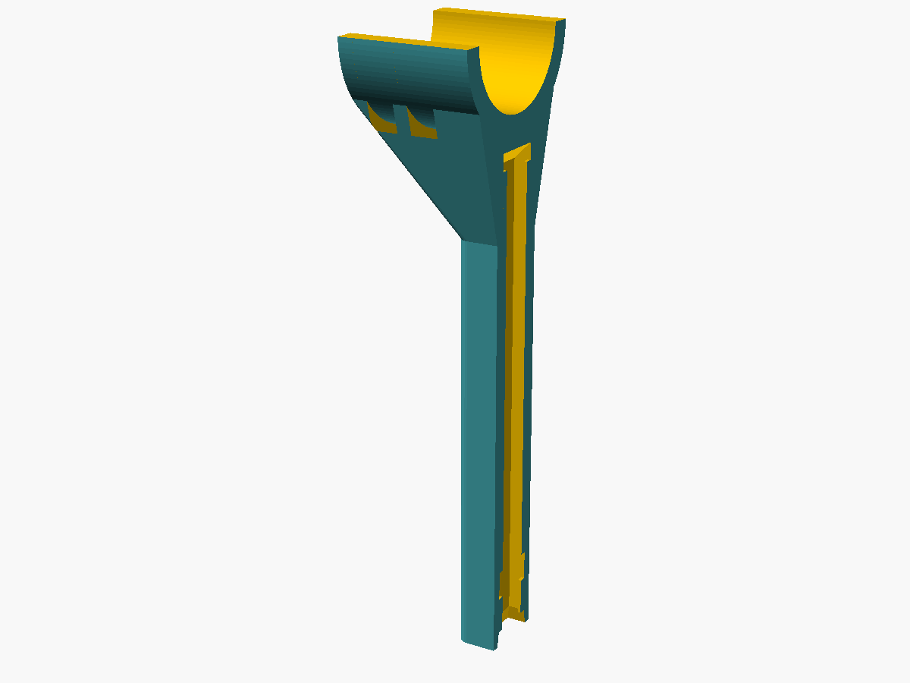

# Joy-Con Handlebar Mount (direct to bar)

Holds **one** Nintendo Switch (1) Joy-Con just inboard of the hood, face up,
pointing forward, roughly where a Zwift Play controller sits. A strap clamp
goes on the bar tops near the bend, and a rail beam runs forward from it. The
Joy-Con slides in from the front and stops against the closed end of the rail.

**One part fits both sides. Print two.**

| Bar | Holds | How to fit the part |
| --- | --- | --- |
| Left bar | **Right** Joy-Con | As shown below |
| Right bar | **Left** Joy-Con | Turned upside down |

The Joy-Con's rail faces outboard, toward the hood, so the beam sits between
the Joy-Con and the hood.

> **Status: untested.** The rail profile is the same one that passed the rail
> fit test. The clamp has not been printed or fitted on a bike yet.

## Files

- `joycon_handlebar_mount.scad`: source. It needs `../../lib/`.
- `joycon_handlebar_mount.stl` / `.3mf`: in the
  [latest release](../../../../releases/latest), already oriented for
  printing. They use the default `bar_d = 27`.

## The clamp

A one-piece saddle that cradles the front half of the bar. Two channels,
5.2 mm wide and 3 mm deep, run around the outside of the saddle and under the
beam. Pass a strap through each channel and around the back of the bar.

- Made for zip ties (up to 4.8 mm wide). Narrow velcro or Garmin-style rubber
  O-rings also fit.
- Works on taped or slightly curved bar sections, over a range of bar sizes.
- For more grip, add a strip of rubber (old inner tube, a scrap of bar tape)
  between the saddle and the bar, and set `liner_t` to its thickness so the
  saddle is sized for it.

## Print orientation

The file stands the mount on the **front end of the rail beam**, so the rail
runs vertically, like the grip, and the rail lips never float. The closed end
of the rail is sloped, and the web between the clamp and the beam has no
downward-facing surface flatter than 45°. The only flat overhangs are short
bridges over the strap channels.

## Fitting

1. Put the mount on the bar tops just inboard of where the bar starts to bend
   forward, with the whole clamp on the straight section. For the right bar,
   turn the part upside down first.
2. Rotate it on the bar until the Joy-Con will sit level (or angled how you
   like), then pull the zip ties tight.
3. Slide the Joy-Con in from the front, rail first, until it clicks.

## Parameters worth changing

| Parameter | Default | What it does |
| --- | --- | --- |
| `bar_d` | 27 | Bar diameter **with tape** at the clamp spot (typically 24–32) |
| `clamp_w` | 25 | Clamp width along the bar |
| `clamp_x_offset` | 0 | Slide the clamp along the bar (− = outboard) |
| `rail_forward` | 0 | Extra gap between the bar and the Joy-Con |
| `rail_dz` | 0 | Raise (+) or lower (−) the Joy-Con relative to the bar centre. See below |
| `yaw` | 0 | Turn the front of the Joy-Con toward (+) or away from (−) the hood |
| `beam_w` | 8 | Beam width; increase it for a stiffer beam |
| `strap_w` | 5.2 | Strap channel width |
| `liner_t` | 0 | Room for a rubber liner inside the saddle |

**About `rail_dz`:** it's the one setting that breaks the "one part for both
sides" rule. Turning the part upside down for the right bar also flips the
offset, so a Joy-Con raised 5 mm on the left bar sits 5 mm lower on the right.
If you change it, print one part with your value for the left bar and one with
the opposite value (for example `5` and `-5`) for the right bar. All the
other settings work the same on both sides.

The clamp always sits outboard of the rail face, so it never collides with the
Joy-Con. The Joy-Con's rear end clears the bar by 2 mm (`jc_clear`).

## Open questions

- **Bar diameter at your clamp spot**, with tape. 27 mm is a guess for taped
  tops near the bend.
- **Hood clearance:** does the beam (8 mm outboard of the Joy-Con) touch the
  inside of your hood, or the bar where it starts to curve? Adjust with
  `clamp_x_offset`, `rail_forward`, `rail_dz`, and `yaw`.
- **Does it hold?** Check that hard button presses don't rotate the clamp on
  the bar. A rubber liner helps.
- **Beam stiffness:** the beam is 8 × 14 mm and about 98 mm long. If button
  presses make it flex or twist, increase `beam_w`.
