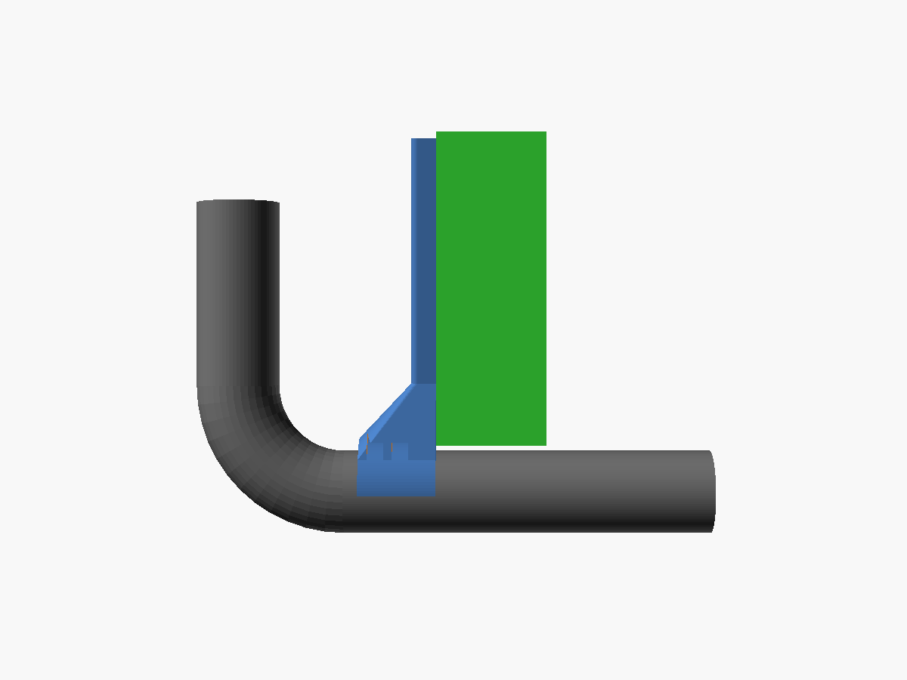
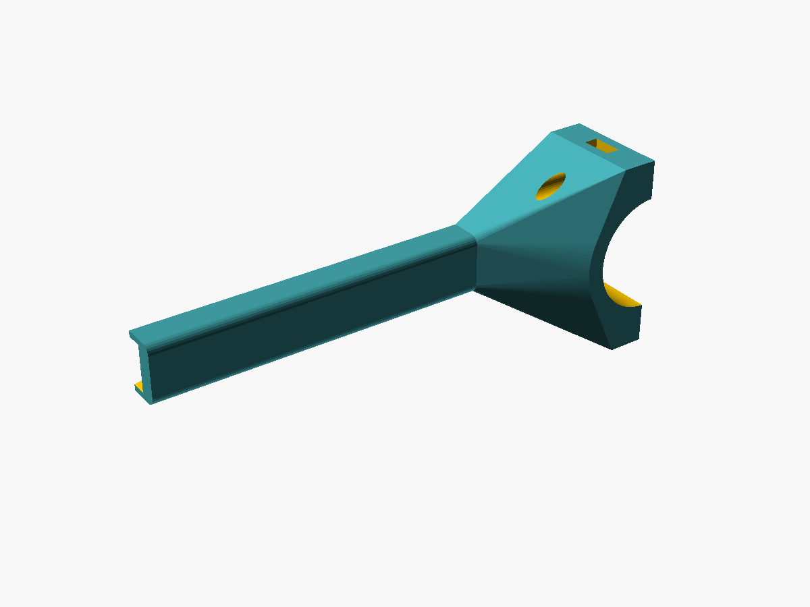
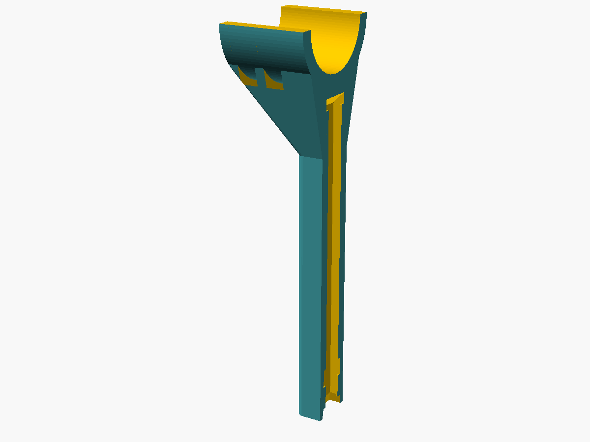

# Joy-Con Handlebar Mount (direct to bar)

Holds **one** Nintendo Switch (1) Joy-Con just inboard of the hood, face up, pointing forward — roughly where a Zwift Play controller sits. A small clamp goes on the bar tops near the bend, and a rail beam runs forward from it. The Joy-Con slides in from the front and stops against the closed end of the rail.

| Bar | Holds | `side` |
|---|---|---|
| Left bar | **Right** Joy-Con | `"left"` |
| Right bar | **Left** Joy-Con | `"right"` |

The Joy-Con's rail faces outboard, toward the hood, so the beam sits between the Joy-Con and the hood.

> **Status: untested.** The rail profile is the same one that passed the rail test print. The clamp has not been printed or fitted on a bike yet.

## Files

| File | What it is |
|---|---|
| `joycon_handlebar_mount.scad` | Parametric OpenSCAD source (uses `../../lib/joycon_rail.scad`) |
| `joycon_handlebar_mount_left_strap.*` | Left bar, strap clamp (one piece) |
| `joycon_handlebar_mount_right_strap.*` | Right bar, strap clamp |
| `joycon_handlebar_mount_left_bolt.*` | Left bar, bolt clamp: beam half |
| `joycon_handlebar_mount_right_bolt.*` | Right bar, bolt clamp: beam half |
| `joycon_handlebar_mount_bolt_cap.*` | Bolt clamp: rear cap (same for both sides) |
| `joycon_handlebar_mount_tpu_shim.*` | Optional TPU shim for the bolt clamp |

STL and 3MF files are in the [latest release](../../../../releases/latest). They use the defaults (`bar_d = 27`) and are already oriented for printing.

## Clamp styles

### `clamp_style = "strap"` (default)
A one-piece saddle that cradles the front half of the bar. Two channels, 5.2 mm wide and 3 mm deep, run around the outside of the saddle and through the web under the beam. Pass a strap through each channel and around the back of the bar.

- Works on taped or slightly curved bar sections, over a range of bar sizes.
- Takes zip ties (4.8 mm), narrow velcro, or Garmin-style rubber O-rings.
- For grip, add a strip of rubber (old inner tube, a scrap of bar tape) between the saddle and the bar. Set `liner_t` to its thickness so the saddle is sized for it.

### `clamp_style = "bolt"`
A two-piece split clamp. The beam half has two side-loaded M4 nut slots. The rear cap has counterbored holes for the bolt heads.

- Hardware: **2× M4×12 (or M4×16) socket-head bolts and 2× M4 nuts.** Slide each nut into the slot from the side.
- The halves leave a 1 mm gap, so the bolts can squeeze the bar.
- The bore is exactly `bar_d`. For a smaller bar, print the **TPU shim**: a split sleeve `shim_t` (1 mm) thick, so the default clamp fits a 25 mm bar. Or re-render with your own `bar_d`.

## Print orientation

- **Mount (either style):** stands on the **front end of the rail beam**, with the rail running vertically like the grip. The rail lips never float, and the closed end of the rail is sloped at 45°. The web between the clamp and the beam is shaped so every downward-facing surface is 45° or steeper. The only flat overhangs are short bridges over the strap channels (5.2 mm) and nut slots (7.3 mm).
- **Bolt cap and TPU shim:** print standing on an end face (bar axis vertical), no supports.
- The optional shim is meant to be printed in TPU.
- Checked with a slice-by-slice island test on the exported meshes: no floating regions.

## Fitting

1. Slide the clamp onto the bar tops just inboard of where the bar starts to bend forward. Keep the whole clamp on the straight section.
2. Rotate it on the bar until the Joy-Con sits level (or angled how you like), then tighten the straps or bolts.
3. Slide the Joy-Con in from the front, rail first, until it clicks.

## Parameters worth changing

| Parameter | Default | What it does |
|---|---|---|
| `side` | `"left"` | Which bar (and therefore which Joy-Con) |
| `clamp_style` | `"strap"` | `"strap"` or `"bolt"` |
| `bar_d` | 27 | Bar diameter **with tape** at the clamp spot (typically 24–32) |
| `clamp_w` | 25 | Clamp width along the bar |
| `clamp_x_offset` | 0 | Slide the clamp along the bar (− = outboard) |
| `rail_forward` | 0 | Extra gap between the bar and the Joy-Con |
| `rail_dz` | 0 | Raise or lower the Joy-Con relative to the bar centre |
| `yaw` | 0 | Turn the front of the Joy-Con toward (+) or away from (−) the hood |
| `beam_w` | 8 | Beam width; increase it for a stiffer beam |
| `liner_t` | 0 | Room for a rubber liner (strap clamp) |
| `shim_t` | 1.0 | TPU shim thickness (bolt clamp) |

The clamp always sits outboard of the rail face, so it never collides with the Joy-Con. The Joy-Con's rear end clears the bar by `jc_clear` (2 mm).

## Clamping ideas

| Option | Pros | Cons |
|---|---|---|
| **Rubber O-rings** (Garmin-style) | Tool-free, quick to move, gentle on bar tape, spares are cheap | Can creep under hard button presses; pick a size that's tight around saddle + bar |
| **Zip ties** | Cheapest, very secure, fit the channels exactly | One-time use; can bite into bar tape; cut carefully to remove |
| **Velcro / hook-and-loop strap** | Reusable, adjustable, kind to tape | Bulkier; needs a narrow strap (or widen `strap_w`) |
| **Bolt clamp + TPU shim** | Most rigid, won't rotate, repeatable position | Needs M4 hardware and a tool; must match the bar diameter (shim helps) |
| **Hose clamp** (small worm-drive) | Very strong, adjustable over a wide range | Metal on the bar or tape; sharp edges; looks rough |

A rubber liner (inner tube strip) under the strap saddle helps a lot with rotation.

## Open questions

- **Bar diameter at your clamp spot**, with tape. 27 mm is a guess for taped tops near the bend.
- **Hood clearance:** does the beam (8 mm outboard of the Joy-Con) touch the inside of your hood, or the bar where it starts to curve? Adjust with `clamp_x_offset`, `rail_forward`, `rail_dz`, and `yaw`.
- **Left/right:** confirm the right Joy-Con on the left bar (and vice versa) is the layout you want. The Joy-Con stick ends up nearest the rider.
- **Beam stiffness:** the beam is 8 × 14 mm and about 98 mm long. If button presses make it flex or twist, increase `beam_w`.
- **Option 1** from the photo (mounted to the side of the hood) is not modelled yet.
